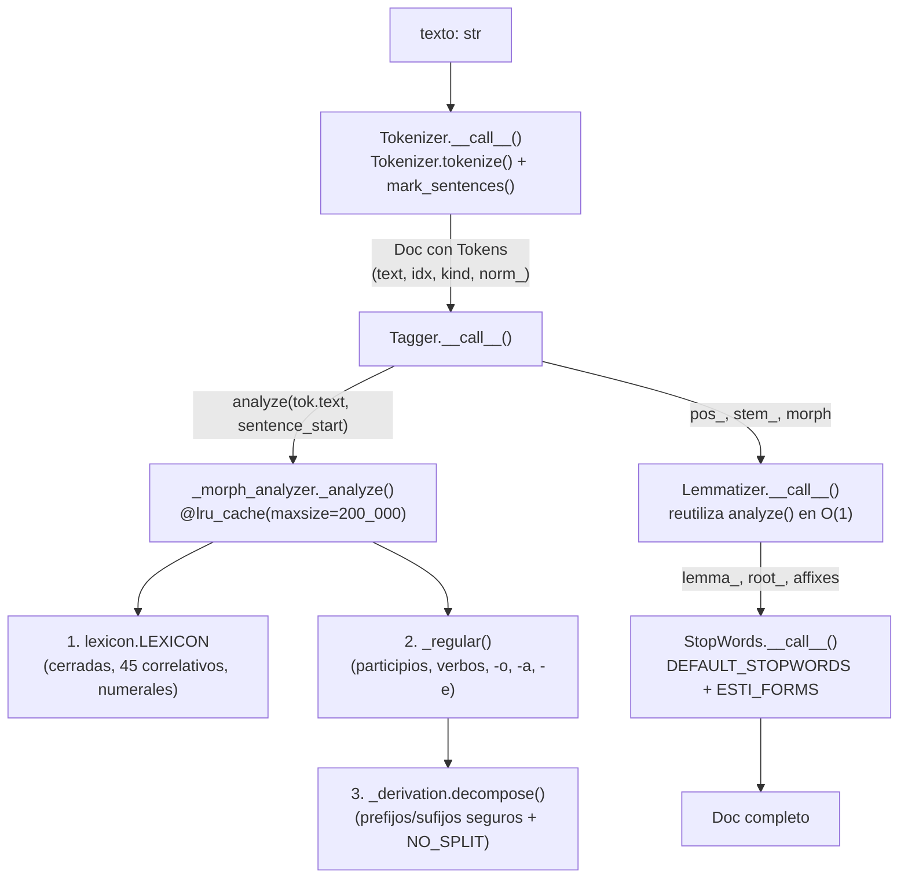

# Guía de Flujos y Arquitectura de Llamadas (`esperanto-nlp`)

Este documento traza **cómo se conectan entre sí los archivos, funciones y salidas** del proyecto completo a lo largo de sus tres fases, explicando el recorrido exacto desde que los datos entran hasta que se obtienen las métricas y predicciones finales.

---

## Visión general de extremo a extremo

```mermaid
flowchart LR
    W["Vikipedio (API MediaWiki)"] -->|"Fase 1: build_dataset.py"| D[("data/dataset.csv\ndataset_meta.csv")]
    D -->|"validate_dataset.py + noise_report.py"| V["Corpus validado\n(1.500 párrafos, 464 artículos)"]
    V -->|"Fase 2: esperanto_nlp.load()"| NLP["Doc / Token\n(pos_, lemma_, stem_, root_, is_stop)"]
    NLP -->|"Fase 3: EsperantoPreprocessor"| ML["Pipeline scikit-learn\n(TF-IDF + Clasificador)"]
    ML -->|"clasificacion_esperanto.ipynb"| OUT["Métricas sin leakage\n+ Clasificación web"]
```

---

## Fase 1 · Datos, ETL y Calidad del Corpus

### 1.1. Construcción del dataset (`scripts/build_dataset.py`)
Orquesta el pipeline **Extract → Transform → Load** parametrizado por `scripts/dataset_config.json`:

1. **Entrada CLI y configuración:**
   * `main()` → `_apply_overrides()` (aplica `--depth` si se pasa por consola) → `load_config()` → despacha `cmd_subcats()`, `cmd_explore()` o `cmd_build()`.
2. **Extract (API MediaWiki con cortesía y caché):**
   * `make_session()` crea una `requests.Session` con `User-Agent` descriptivo (importación perezosa de `requests`).
   * En `subcats`: `describe_subcategories()` → `category_members()` + `category_info()` → `api_get()` lista tamaños para detectar manualmente ramas ruidosas (`exclude_subcategories`: biografías, esbozos `Ĝermoj pri...`, ficción).
   * En `explore` / `build`: `collect_candidates()` → `crawl_category()` (respetando `class_depth`: `fiziko: 1`, `biologio: 1`, `kemio: 2`) → `category_members()` con paginación `cmcontinue` → `fetch_article()` descarga los textos y los cachea en `data/raw/*.json`.
3. **Transform (desambiguación y limpieza compartida):**
   * `drop_ambiguous()` elimina artículos que pertenezcan a más de una categoría.
   * `build_rows()` → `article_paragraphs()` → `extract_paragraphs()` (descarta cabeceras `== ... ==` y corta en `== Referencoj ==`).
   * Cada párrafo pasa por `esperanto_nlp.cleaning.clean_paragraph()` (elimina HTML, URLs, plantillas `{{...}}`, citas `[1]` y convierte `;` en `,`) y `is_valid_paragraph()` (120–1.500 caracteres, $\ge 15$ palabras, puntuación terminal y `min_alpha_ratio >= 0.6`).
   * **Por qué está `cleaning.py` dentro de `src/esperanto_nlp/`:** para que la Fase 1 (ETL) y la Fase 3 (scraping web) limpien exactamente igual, evitando *train/serve skew*.
4. **Load (balanceo y trazabilidad):**
   * `balance_rows()` submuestrea de forma determinista (`seed = 42`) hasta igualar 500 párrafos por clase (`fiziko`, `biologio`, `kemio`).
   * `write_outputs()` genera:
     - `data/dataset.csv`: `text;class` (UTF-8 sin BOM).
     - `data/dataset_meta.csv`: `row`, `class`, `article_id`, `article_title`, `revid`, `text_sha256` (necesario en Fase 3 para agrupar por artículo).
     - `data/dataset_stats.json`: configuración usada y conteos finales (464 artículos en total).

### 1.2. Validación del contrato (`scripts/validate_dataset.py`)
* `main()` → `esperanto_nlp.contract.validate_file()` → decodifica UTF-8 estricto → `validate_csv_text()` → devuelve `ContractReport` (`ok`, `errors`, `warnings`, `stats`).
* Comprueba cabecera `text;class`, ausencia de `;` dentro de `text`, HTML, URLs, citas `[1]` y balance mínimo de clases.

### 1.3. Auditoría de ruido (`scripts/noise_report.py`)
* `main()` sigue tres modos excluyentes:
  * **Automático (por defecto):** `read_dataset()` → `esperanto_nlp.load()` → `content_lemmas()` → `keywords_per_class()` (top-30 por ratio logarítmico de frecuencia) → cuenta cuántos párrafos de cada clase no contienen ninguna palabra clave de su clase (indicador léxico exploratorio, no tasa de error real).
  * **Muestreo + Anotación (`--sample` / `--annotate`):** genera `noise_sample.csv` estratificado y `annotate()` llama a `read_sample()` y guarda cada etiqueta (`0`, `1`, `2`) de forma atómica con `save_sample()` (`tempfile` + `os.replace`).
  * **Análisis (`--analyze`):** `analyze_sample()` resume porcentajes de informativos (`0`), genéricos (`1`) y otra temática (`2`).

---

## Fase 2 · Librería de NLP basada en reglas (`src/esperanto_nlp/`)

Al ejecutar `nlp = esperanto_nlp.load()` (`__init__.py` → `pipeline.py:load()`), se instancia `EsperantoNLP` con `Tokenizer` y `[Tagger(), Lemmatizer(), StopWords()]`. Al llamar a `doc = nlp(texto)`:

### 2.1. Paso 1 — Normalización y Tokenización (`normalization.py`, `tokenizer.py`, `containers.py`)
* `Tokenizer.__call__(text)` → `Tokenizer.tokenize(text)` evalúa `TOKEN_RE` en orden estricto (`url` → `abbr` → `number` → `word` → `punct`).
* Para cada palabra (`kind == "word"`), calcula `norm_` llamando a `normalize_word()` → `normalize_text()` (`unicodedata.normalize("NFC", ...)` + `_x_replace()` para `cx/gx/hx/jx/sx` + `_ux_replace()` para `ux` **solo tras vocal**, evitando romper palabras como `lux`).
* `mark_sentences()` → `_period_ends_sentence()` marca `is_sent_start` sin cortar en iniciales (`L. L. Zamenhof`) ni abreviaturas (`ekz.`, `k.t.p.`).
* `Token.text` e `idx` nunca se alteran: `doc.text[t.idx:t.end_idx] == t.text` siempre.

### 2.2. Paso 2 — Motor morfológico y Etiquetado (`_morph_analyzer.py`, `lexicon.py`, `_derivation.py`, `tagger.py`)
* `Tagger.__call__(doc)` asigna directamente `PUNCT`/`NUM`/`X` a signos, números, URLs y abreviaturas (`{"Abbr": "Yes"}`); para `kind == "word"` invoca `analyze(tok.text, sentence_start=tok.is_sent_start)`.
* `_analyze()` (decorado con `@lru_cache(maxsize=200_000)`) aplica en orden:
  1. Números/signos.
  2. **Léxico cerrado primero (`LEXICON` de `lexicon.py`):** preposiciones, conjunciones, artículo `la`, pronombres/posesivos (`_reg_inflected`) y 45 correlativos generados (`CORRELATIVE_PREFIXES` × `CORRELATIVE_SUFFIXES`). Evita que `kio` parezca sustantivo `-o`.
  3. Letras ajenas a `ESPERANTO_ALPHABET` (`q, w, x, y`) y siglas cortas (`ONU`) → `PROPN` o `X`.
  4. Numerales compuestos (`is_compound_numeral()` por programación dinámica) y ordinales (`dudeka`).
  5. Mayúscula fuera de inicio de frase → `_propn()` + `_proper_lemma()` (`Parizon` → lema `Parizo`, raíz `pariz`).
  6. `_regular()` → participios (`_NON_PARTICIPLE_STEMS` evita `elef-ant-o`), verbos (`esti` → `AUX`), `-o` (`NOUN`), `-a` (`ADJ`), `-e` (`ADV`), validando `_valid_stem()`.
  7. `_mk(..., derive=True)` llama a `_derivation.decompose(stem)` para aislar afijos seguros (`mal-`, `-ist`, `-ej`, `-ig`, `-iĝ`, `-ebl`, `-ind`, `-ec`, `-ism`, `-eg`, `-aĵ`, y `-in` tras `-ist`) respetando `_ok()` ($\ge 3$ letras + vocal) y `NO_SPLIT`.
* `Tagger` rellena `tok.pos_`, `tok.stem_` y `tok.morph` (como `dict` mutable a partir de `MappingProxyType`).

### 2.3. Paso 3 — Lematización y Stop-words (`lemmatizer.py`, `stopwords.py`)
* `Lemmatizer.__call__(doc)` vuelve a llamar a `analyze()` (acierto en caché $O(1)$) y rellena `tok.lemma_` (participios al infinitivo: `kuranta` → `kuri`), `tok.root_` (raíz primaria sin afijos: `lernejoj` → `lern`) y `tok.affixes`.
* `StopWords.__call__(doc)` fija `tok.is_stop = tok.kind == "word" and tok.norm_ in self.words`, donde por defecto `self.words` contiene `DEFAULT_STOPWORDS` (palabras funcionales cerradas de `lexicon.py` + `ESTI_FORMS`).
* El `Doc` final expone `doc.sents` (`Span`), `doc.to_list(attr, drop_stop=..., drop_punct=..., keep_pos=...)` y `doc.to_dicts()`.

### 2.4. Paso 4 — Explicabilidad en español (`glosario_es.py`, `scripts/probar_frase.py`)
* `scripts/probar_frase.py:main()` → `mostrar()` / `mostrar_tecnico()` consulta `pos_es()`, `glosa()` (diccionario orientativo `GLOSARIO`) y `explicar_token()` → `descomponer()` + `_terminacion()` + `feats_es()` para mostrar el desglose morfológico en español.

---

## Fase 3 · Aprendizaje Automático, Cuaderno y Verificación

### 3.1. Puente con `scikit-learn` (`src/esperanto_nlp/sklearn_wrapper.py`)
* `EsperantoPreprocessor(feature=...)` hereda de `BaseEstimator` y `TransformerMixin`:
  * `fit(X, y)` valida que `feature` esté en `{"text", "norm", "lemma", "stem", "root"}`.
  * `transform(X)` llama a `_preprocess(...)` (`@lru_cache(maxsize=200_000)`), que obtiene `_get_nlp(x_system)(text)` y ejecuta `doc.to_list(attr, drop_stop=..., drop_punct=..., drop_num=..., keep_pos=...)`, devolviendo cadenas separadas por espacios para `TfidfVectorizer(tokenizer=str.split, token_pattern=None, lowercase=False)`.
  * Al ser un preprocesado determinista sin estado entrenado y no guardar `nlp` como atributo del estimador, funciona con `clone()`, `pickle` y `GridSearchCV` sin provocar *data leakage* entre *folds*.

### 3.2. Cuaderno de clasificación (`notebooks/clasificacion_esperanto.ipynb`)
1. **Carga y verificación:** lee `data/dataset.csv` y `data/dataset_meta.csv` (o los descarga desde `EduardoEO/nlp-esperanto-practice` en modo remoto/Colab); `aligned_metadata()` verifica longitud, clase y `text_sha256` fila por fila.
2. **Partición sin fuga de datos:** `make_cv()` usa `StratifiedGroupKFold` sobre `meta.article_id` tanto para separar train/test como para la validación cruzada interna.
3. **Modelado y ablación:** compara representaciones (`text`, `norm`, `lemma`, `stem`, `root`) y clasificadores sobre `CV_TRAIN`, evalúa una sola vez el modelo principal sobre test e inspecciona coeficientes con `con_glosa()`.
4. **Clasificación web:** descarga artículos externos (o usa `data/fallback_web_text.txt` en modo `--offline`), limpia párrafos con `clean_paragraph()` / `is_valid_paragraph()`, excluye títulos ya presentes en el corpus de entrenamiento y calcula probabilidades medias por clase.

### 3.3. Sincronización, ejecución automática y CI
* `scripts/sync_notebook_snapshot.py`: `snapshot()` empaqueta `src/esperanto_nlp/*.py` en `EMBEDDED_LIBRARY_B64` + `EMBEDDED_LIBRARY_SHA256` dentro del cuaderno (verificado por `tests/test_notebook_integrity.py::test_embedded_library_matches_source`).
* `scripts/run_notebook.py`: ejecuta el cuaderno completo mediante `NotebookClient` (`--offline`, `--remote`, `--emergency`) y guarda logs/métricas en `salidas/`.
* `scripts/check_project.py` y `scripts/diagnostico.py`: ejecutan localmente `pip check`, `pytest` (188 pruebas en 10 módulos), `validate_dataset.py`, `noise_report.py` y `run_notebook.py --offline`.
* `.github/workflows/ci.yml`: en cada `push` / `pull_request` ejecuta `tests` (Python `3.11`, `3.12`, `3.13`: `pytest --cov=esperanto_nlp`, `run_notebook.py --offline` en `3.12`, `validate_dataset.py`) y `docs` (`mkdocs build --strict` usando `mkdocs.yml`).
